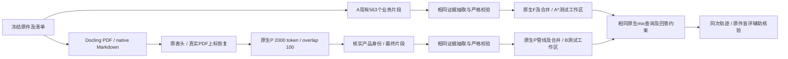

# 保险 B 最终候选与对照口径

实现位于当前项目的 `applications/insurance_b/`，复用本项目 SDK 和虚拟环境。没有新建项目或 worktree，没有修改 `applications/insurance/`、master 配置、原件、数据库或 9623 服务。最终运行记录及实测结论以 `output/comparison/final/report.md` 为准。

## 已实现链路

同一批7产品、21份原件（14份文字PDF、7份Markdown）统一进入一个候选工作区。产品业务版本未确认时保持未知，运行编号不能代替业务版本。



B明确通过 `apipeline_enqueue_documents`、`pending_parse`、`process_options=P` 和 `apipeline_process_enqueue_documents` 入库，不用普通 `ainsert` 冒充P。逐文件检查实际parser、`paragraph_semantic`标记、sidecar来源、最终片段、抽取台账、原生图和向量。原生P输出、最终索引内容和证据输入分别保存。

PDF关闭OCR、强制OCR、公式增强和额外多模态分析。Docling为现有OrbStack容器，地址 `http://127.0.0.1:5001`。本轮没有扫描件/OCR或DOCX的业务验收结论。

## 缺陷驱动修正

| 位置 | 修正及保留证据 |
| --- | --- |
| `structure_repair.py` | 在P前恢复同文件sidecar中真实表头，拒绝与改变后的表体绑定，保留0、空白和破折号 |
| `input_adapters/pdf_math.py` | 用原PDF小号、抬高文字的几何位置核实变量指数，记录物理页和原字形；出现次数不一致即阻断，不计算保险金额 |
| `input_adapters/source_context.py` | 将已核实的原文产品名称及明确标注的非合同来源信息加入最终P片段，在原生哈希、向量化和存储前完成；单独保存原P输出 |
| `evidence_adapter.py` | 对表格及紧邻标题、空白和注释保留连续原文证据；表格投影保持原单元格次序，偏移指向实际投影 |
| `_current/source_scope.py` | 将原文Markdown、数字及中文上级标题识别为计划边界，避免最后一个计划吞入免责或总体利益 |
| `_current/evidence_semantics.py` | 识别原文明示的部分领取、保单贷款申请用途；严格拒绝无用途证明的材料分类 |
| `profiles_current/` | 投保、承保、核保及投保时缴费安排材料不误分为理赔或保全材料；未放松语义校验 |
| `query_guard.py` | 从同次原文定位责任及计划标题、严格金额边界；拦截可定位的跨计划积极公式断言；无具体依据不得将负面审核提升成通过 |

以上不包括按真实产品或标准答案写专属分支。共用合同修改均有快照、原始哈希及可逆补丁记录；原A文件保持原样。回答自审仍会失败或误判，不能代替独立原件核验。被拦截的回答计为交付失败，不算答对。

## A/B定义与归因

最终两组为A2（workspace `insurance_b_a2`）和B1f2（workspace `insurance_b1f2`），各自重新抽取、合并和构建索引，不复用开发期选择台账。

A*使用A现有业务准备产物，双方共用当前冻结的抽取/回答合同及已声明修正。因此本轮主要比较两种资料准备链路；A*不是未修正线上A的成绩。对齐旧B回答合同、修正共用提示或校验的收益不能归因于P，本轮结果也不能直接作为替换当前A的证明。

实际开发运行存在额外变量：A预审每个输入最多3次模型选择；B有一份输入经3次原生处理、实际9次模型选择才通过。全部调用计入账目。本轮因此是开发整链路对照，不能称为严格只比较解析/P的实验；基础合同哈希一致不代表重试上限完全相同。

双方的抽取/关键词模型为qwen3.8-flash，回答为qwen3.7-plus，embedding为qwen3.7-text-embedding、1024维，rerank为qwen3.7-text-rerank。使用mix、top_k=30、chunk_top_k=12、实体/关系/总token预算2000/2500/18000，空历史，温度0，关闭应用答案缓存。

29道原题各独立回答3次，每组87次请求，不同问题数仍为29；其中含同源及同事实回归题，不能假定完全统计独立。原题已用于开发，不是未见验收集。必需事实核查点只进入独立评审，不进入抽取、索引或查询输入。匿名答案盲评为模型辅助核验，正式业务人员验收仍需另行完成。

B复用14份原始PDF解析缓存，A复用既有业务准备产物，所以不比较冷解析总成本。报告使用实际提供商token回执；没有可靠价格、embedding/rerank用量或提供商缓存命中时明确记未知。主实验的新抽取建库、同索引三轮回答与独立重建稳定性须分开报告。

## 隔离和操作

PostgreSQL固定为 `127.0.0.1:15433`、database `insurance_b`；Neo4j Bolt为 `17687`、HTTP为 `17474`；B本地API为 `9625`。配置只显式加载B目录内的 `B_` 变量，私有 `.env` 不进入Git。写入使用工作区独占锁。

从项目根运行：

```bash
export EMBEDDING_FUNC_MAX_ASYNC=1
export EMBEDDING_BATCH_NUM=2
export EMBEDDING_TIMEOUT=120
.venv/bin/python -m applications.insurance_b.cli --config applications/insurance_b/config/b1f2.env verify
.venv/bin/python -m applications.insurance_b.cli --config applications/insurance_b/config/b1f2.env evaluate --repeats 3
```

现有结果不可用相同运行号覆盖调参。代码、提示、源文件或关键配置改变后，使用新的运行号和工作区；人工重试走原生明确重试通道，不手工重置状态或拼写底层记录。

完整读回通过后才能启动对应B本地验证入口。只更新B入口，不切换A、不合并两个实验图、不删除历史失败。业务门槛未通过或人工事实/证据核验未完成时保留A，B仅作本地测试候选。
