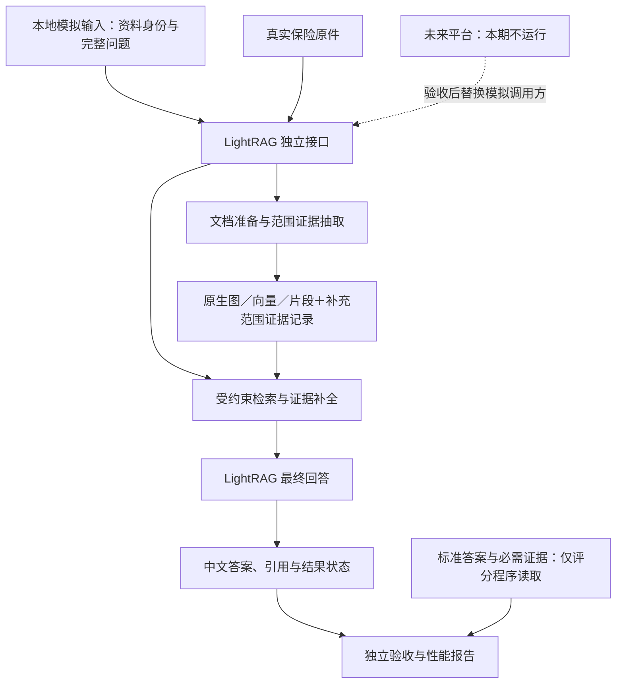
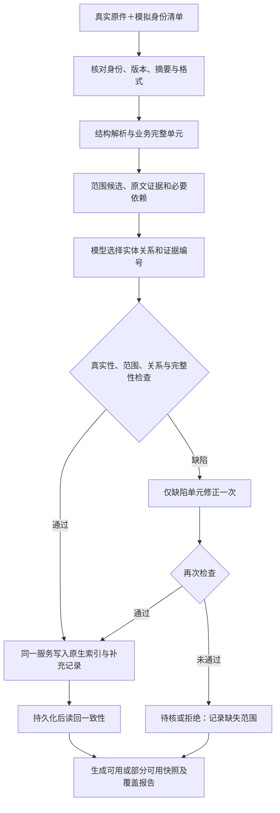
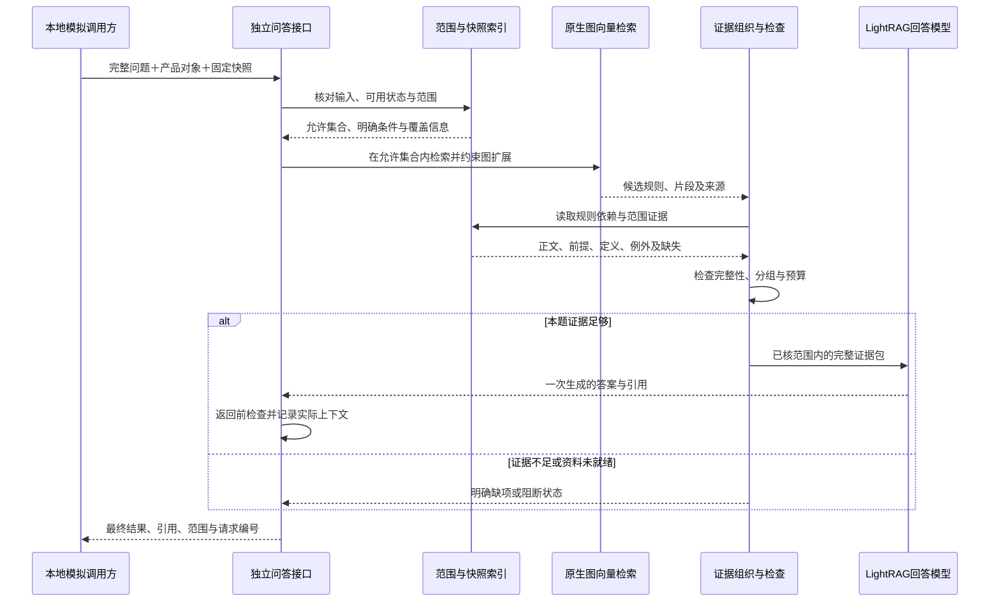

# LightRAG 1.5.7 保险产品知识问答独立开发与验收方案

> **版本：V3.0｜范围收敛版｜修订日期：2026-11-11**
> **实施项目：仅 `tielei60/LightRAG`。本期不进入、不修改、不启动问答平台项目。**
> **当前状态：设计文档。本次未开发代码、未重新审查远端最新提交、未执行真实模型或独立验收。**

## 文档阅读说明

本版基于《LightRAG 1.5.7 保险产品抽取与问答质量改进方案》及最新确认的项目分工修订。保留“关系适用范围、证据完整性、原文可追溯、LightRAG 最终回答”的技术方向，把平台主数据、会话、问题理解和业务路由全部移出本轮实施范围。[S1][S2]

旧版审查快照为分支 `codex/product-import-1.5.7`，提交 `714c2bf17ebf7864d046fe42485e4f6edfdde79a`。本文涉及仓库现状的描述均沿用该快照审查记录，不表示重新确认了远端当前状态；实际开发开始时，先记录真实起始提交并核对相关文件，不扩大成全仓库重构。[S1]

本文中新增模块、接口、字段、状态、测试要求均是**拟实施设计**，不是 LightRAG 1.5.7 已经具备的原生能力。代码位置供定位修改，不要求机械拆成多个服务。历史早期方案中的 Spring Boot、第二套产品后台、费率、权限、多模态、核保和生产部署，不作为本轮任务。[S3]

---

## 1. 本轮目标与完成定义

### 1.1 唯一目标

**在问答平台完全不参与运行的条件下，使 LightRAG 能独立完成保险文档导入、知识抽取、适用范围管理、检索、证据组织、最终回答及质量验收。**

需要平台提供的产品身份、文档信息、完整问题等，先用本地模拟输入代替。模拟输入只是平台输入合同的替身，不能代替 LightRAG 从原文理解计划、责任和规则。

本轮完成后的调用形态：

```text
本地模拟调用方
    → 产品资料与基础身份 / 完整问题与查询对象
    → 独立 LightRAG 服务
    → 最终中文答案、引用、适用范围和结果状态
    → 独立验收程序与人工原文核验
```

平台接入是**下一阶段**：只更换调用方，不把核心抽取、检索和回答流程重新搬到平台实现。

### 1.2 独立验收通过的含义

必须同时满足：平台服务未启动、平台数据库不可访问、没有导入平台代码包，也能从固定原件建立新的候选知识库，并通过本文件规定的真实问答、混库范围、证据完整性、重启恢复和性能检查。

“独立”不意味着禁用模型服务。LLM、Embedding 及实际配置的重排服务可以是外部服务，但其连接配置必须由 LightRAG 项目自己提供，不在运行时读取平台 `.env` 或调用平台模型代理。

### 1.3 本期做与不做

| 本期必须完成 | 本期明确不做 |
|---|---|
| 中文文档解析、完整切片、实体和关系抽取改进 | 平台产品管理、产品别名管理和产品族管理后台 |
| 计划／责任／条件／例外的原文范围识别 | 平台意图识别、问题改写、多轮会话、历史压缩 |
| 原文证据、来源位置和必要依赖保留 | 用户、组织、登录、权限开发 |
| 有范围约束的检索与最终上下文组织 | 费率或现金价值计算、核保决策、多模态、OCR |
| LightRAG 一次生成最终答案与引用 | 生产部署、高可用、复杂发布平台、工作流引擎 |
| 本地模拟输入、独立 HTTP 调用、回归测试 | 同时修改两个仓库、平台联调、平台 E2E |
| 重启、重复导入、文档替换／删除后的正确性 | 为所有存储后端增加兼容实现 |

文档中出现的投保条件可以作为资料解释内容；不据此开展自动核保。条款中的公式、比例、期间应完整保留，但不执行费率或保险金金额计算。

---

## 2. 平台与 LightRAG 的最终职责

| 能力 | 平台职责，当前仅模拟 | LightRAG 本轮职责 |
|---|---|---|
| 产品身份与基本信息 | 唯一业务维护入口，提供产品 ID、名称等 | 接收只读身份，不新增产品业务维护体系 |
| 产品族、销售名、别名 | 确定实际查询产品集合 | 接收解析结果，不重新开展模糊别名识别 |
| 文档发布与业务版本选择 | 决定使用哪些资料 | 核对接收版本、文件摘要、索引和可答状态 |
| 问题理解与上下文 | 形成独立、完整的问题 | 不建设会话系统，不再次做平台级意图路由 |
| 计划、责任、规则知识 | 不预先替 LightRAG 得出业务结论 | 从真实原文提取，并保留适用范围和依据 |
| 检索范围 | 提供已确定的产品和用户明确条件 | 校验输入，约束召回、图扩展和证据使用 |
| 答案与产品对比 | 确定问什么、比哪些产品 | 分组取证，生成一份最终答案 |
| 展示和记录 | 渲染答案、引用，保存会话 | 返回答案和引用，保存知识处理诊断 |

**两个不能混淆的边界：**

- “用户本次问计划一”是查询条件；“某项规则是否适用于计划一”是需要原文证明的知识。平台可以提供前者，不能替代后者。
- 平台压缩的是历史对话；LightRAG 管理的是本次回答的证据上下文。后者继续保留，不属于重复开发。

LightRAG 仍可做关键词抽取、问题主题定位和证据相关性判断。这些服务于检索，不等于再建设一套会话改写、跨应用调度和产品推荐平台。

---

## 3. 独立运行架构与环境

### 3.1 最小运行组成

| 组成 | 本轮处理 |
|---|---|
| 代码 | 只使用 LightRAG 仓库及其 `product` 适配目录 |
| 本地服务 | 沿用现有 LightRAG 服务，在同一进程内挂载轻量产品接口 |
| 模型配置 | LightRAG 本地私有配置；固定并记录抽取、关键词、回答与向量模型 |
| 数据存储 | 先使用既有本地存储组合；范围与证据补充记录放在工作区内 |
| 产品资料 | 仓库现有原件；以明确清单选择导入范围，不递归导入所有文件 |
| 模拟输入 | 本地产品／文档清单与完整查询请求 |
| 验收工具 | 测试脚本或轻量请求页面；优先复用现有工具，不新建管理后台 |

不要求启动平台 FastAPI、平台 PostgreSQL、Redis、消息队列、统一认证或平台前端。沿用旧版记录中的本地存储方案，不因本次优化更换数据库架构。[S1]

### 3.2 架构关系图



真实模型与真实索引必须参与集成验收。模拟模型可以用于单元测试，但其通过不能替代真实问答验收。

### 3.3 工作区使用

保留当前现场作为只读对照；候选测试使用新的测试工作区。在同一个候选工作区中放入多款产品，验证不会串用产品、计划和责任。不得以每款产品独立一库来规避混库测试。

为版本替换验证建立新候选快照是允许的。这是本地可重建的测试数据，不是建设 active／staging／archive 生产发布系统。

---

## 4. 本地模拟：模拟接口输入，不模拟知识结论

### 4.1 三类文件必须分离

| 文件类别 | 建议位置 | 可被谁读取 |
|---|---|---|
| 产品与文档身份清单 | `product/fixtures/catalog.json` | 导入工具、LightRAG 产品适配层 |
| 查询输入样例 | `product/fixtures/query_cases.jsonl` | 模拟调用方；按接口逐条发送 |
| 标准答案与评价条件 | `product/evaluation/expected_cases.jsonl` | 评分程序和人工核验人员；服务运行路径不得读取 |

路径是设计建议，不要求固定命名；但输入与标准答案的隔离是强制要求。运行时目录和测试输出继续放在 Git 忽略目录中。可公开的合成样例和脱敏测试输入可以纳入版本控制，真实凭据不得提交。

### 4.2 可以模拟的信息

| 信息 | 规则 |
|---|---|
| 产品 ID | 优先复用平台已知 ID；无法取得时使用明确的 `mock-` 前缀 |
| 产品正式名称 | 必须与真实资料身份相符，不模拟不存在的保险产品事实 |
| 保险公司、文档角色 | 使用资料能支持的信息；无法确认则标记未知 |
| 文档 ID、文件位置、摘要 | 本地生成，指向真实原件 |
| 业务版本 | 有已确认版本则记录；未知可为空，不伪造“当前有效版” |
| 测试快照 ID | 程序生成，用于固定本次资料集合；与业务版本分开 |
| 查询产品集合 | 模拟平台已经完成的产品识别或产品族展开结果 |
| 完整问题 | 模拟平台已经完成指代还原和问题改写的输出 |
| 明确计划／渠道条件 | 仅复制用户明确表达或已确认的会话条件；不依据预期答案补填 |

若测试产品族或销售名，模拟调用方可以给出经确认的目标产品集合或底层产品 ID；这只验证 LightRAG 对这些对象的回答，不把“平台别名解析正确率”计入 LightRAG 成绩。

### 4.3 严禁放进模拟请求的信息

不得向服务传入标准答案、预期保障责任列表、应引用的证据 ID、必然命中的 chunk ID、已裁决的条件解释、正确百分比或预设是否赔付结论。不得用“测试题编号→固定答案”分支回答问题。

文档本身确实仅适用于某计划时，可以在清单中记录有出处的文档级关联；但其来源与确认依据必须可核验，不能把整套抽取结果伪装成平台元数据。

### 4.4 三个代表性输入

| 查询 | 模拟输入给 LightRAG | LightRAG 必须自己完成 |
|---|---|---|
| 京康优护有哪些保障责任？ | 产品 ID、完整问题、资料快照；计划未指定 | 识别原文中的计划及责任差异并组织回答 |
| 京康优护计划一包含哪些责任？ | 产品 ID、完整问题；用户明确计划一 | 从资料确定计划一的责任，不把选择计划视为已证明责任成立 |
| 京康优护和京安泰的保障内容有什么差异？ | 两个产品 ID、完整比较问题、资料快照 | 分产品取证、标注差异和缺项，一次生成比较答案 |

这些只是请求形态示例，不是三个问题的标准答案。

### 4.5 不明确问题的边界

独立验收的主输入为完整问题。缺产品对象、请求与产品 ID 明显矛盾、未登记的产品或无法确定的计划标识，返回具体的输入问题状态，不擅自换产品或选择默认计划。

计划未指定是合法输入，不等于错误。LightRAG 应依据原文分计划说明；若计划目录或证据本身不完整，应说明覆盖不足，不反问以规避本应回答的差异。

多轮代词“它”“那款”等由未来平台解决。本轮可以模拟改写后的每一轮输入，但不因此声称已验证平台多轮理解。

---

## 5. 对外合同：现在模拟，以后保持不变

以下接口及字段均为**本项目拟新增合同**，不是声明原生 API 已支持这些参数。先固定合同版本，再开发模拟调用方。无需本期同步修改平台接口。

### 5.1 独立入口

| 拟定入口 | 作用 | 边界 |
|---|---|---|
| `POST /product/ingestions` | 提交本地资料清单，返回导入任务编号 | 文件必须位于配置的本地原件根目录；禁止任意路径读取 |
| `GET /product/ingestions/{id}` | 查看技术处理、质量检查和失败原因 | 不把受理成功或 `processed` 等同业务可答 |
| `POST /product/query` | 输入完整问题及产品范围，返回最终答案 | 核心独立验收接口；不依赖平台 |
| `GET /product/queries/{request_id}/trace` | 读取同次请求的诊断记录 | 仅本地诊断；不通过重新查询拼造上下文 |
| `GET /product/snapshots/{id}` | 查看资料覆盖和可答状态 | 技术快照，不承担业务发布审批 |

实现时挂载到现有 LightRAG 服务，不新建第二个 Web 服务。CLI 或测试页面只是这些接口的调用方。SDK 用于内部实现与底层测试，不构成另一套不同逻辑的正式问答入口。

本期先验收非流式 `/product/query`。流式输出不是阻塞项，不为它新增另一条生成流程；后续启用时，也必须先完成范围与证据检查。

### 5.2 导入合同

最小导入清单包含：合同版本、导入批次、目标工作区、目标快照、产品身份记录、文档记录。每个文档记录原文位置、文件摘要、产品关联、文档角色，以及已确认的业务版本信息。

资料缺版本不应被悄悄认作当前版。允许以固定测试快照开展问答，并在结果中明确“基于该资料快照，业务版本未确认”。实际产品在售状态、发布状态由未来平台决定，不在 LightRAG 中推测。

### 5.3 查询合同

| 字段 | 必需程度 | 含义 |
|---|---|---|
| `contract_version` | 必需 | 输入协议版本 |
| `request_id` | 可由服务生成 | 关联请求、上下文、引用和性能记录 |
| `question` | 必需 | 完整问题；不得携带标准答案或评价条件 |
| `snapshot_id` | 独立验收必需 | 锁定已核对的资料快照，避免隐含“最新”漂移 |
| `targets` | 必需 | 目标产品及用户明确的计划／渠道条件；多产品按对象分别记录 |
| `response_style` | 可选 | 简要说明／表格等展示方式，不改变证据边界 |

`targets` 内的计划留空表示“用户未指定”，不是“所有规则都对所有计划适用”。请求不接受自定义证据白名单或指定必然命中的片段。客户端提供的目标条件是查询边界，不是条款真实性的证明。

用户表达存在错误前提时，保留疑问并核原文。例如“计划一也有住院津贴吗”不能被改写或解释为“计划一具有住院津贴”。如果结构化目标与问题中的产品身份相互矛盾，返回输入不一致，不自行裁决哪个输入正确。

### 5.4 回答合同

返回最终中文答案、结果状态、实际产品与快照、计划／责任范围、引用、缺失或冲突说明、请求编号。引用至少能映射到文档版本和原文位置；页码只在解析位置已确认时返回，不凭模型补造。

| 状态 | 含义 | 禁止行为 |
|---|---|---|
| 回答完成 | 本题所需证据已覆盖，生成已完成 | 不能解释为全产品、任意问题均正确 |
| 部分可回答 | 一部分问题有完整依据，其他部分缺失 | 不能用通用常识补齐缺失产品事实 |
| 证据不足 | 当前没有足够支持性资料 | 不能转写为“明确不保”或“没有限制” |
| 资料未就绪 | 指定版本／快照尚不可用 | 不能悄悄用旧快照代答 |
| 存在冲突 | 同范围资料存在未解决冲突 | 不能让模型择一“调和”后输出确定结论 |
| 输入不完整或不一致 | 必需对象缺失、未知对象或输入矛盾 | 不能偷偷扩大范围全库搜索另一个产品 |
| 处理失败 | 连接、解析或模型等技术失败 | 不能包装成资料无相关规定 |

这些状态是本项目设计值，技术字段名可保持英文；抽取实体、关系、业务状态说明及最终回答全部使用中文。不得为了中文化而破坏原生 API 必需的技术字段名。

### 5.5 原生入口与专用入口

本轮不要求改造原生 WebUI 的全部会话或产品选择能力。WebUI 可继续查看文档、图谱；业务问答验收以 `/product/query` 为准。

对验收工作区，任何可写入资料或产生产品答案的入口都不得绕过本方案。原生入口若不能携带同一资料／范围合同，应明确拒绝用于该工作区，或限制为不生成答案的只读诊断；不能悄悄走无范围的默认链路。保留基线工作区的原生功能，不进行无关改造。

---

## 6. 保留旧版正确方向，缩小需要改变的地方

根据前版快照审查，已有原文边界准备、证据编号抽取、原文复制、产品前缀、基础校验及独立 SDK 原型；它们是本次继续开发的基础，不重建一套 RAG。[S1]

| 已记录的缺口 | 本版处理 | 不扩展成什么 |
|---|---|---|
| 产品前缀不能区分产品内部计划和责任规则 | 增加有证据的范围身份 | 第二套产品主数据系统 |
| 合法编号不证明关系语义与条件完整 | 分层检查支持性、范围和关键条件 | 每次问答都跑完整审核工作流 |
| 内存来源台账、相同文字来源覆盖 | 持久化细粒度来源与对象关联 | 复制全部原生存储到新数据库 |
| SDK 原型与 HTTP 导入未统一 | 复用同一内部服务，在独立 HTTP 入口接通 | 同步联调问答平台 |
| 检索缺少正式范围约束 | 在当前实际后端和图扩展链路接入 | 兼容全部数据库实现 |
| 解析／切片可能丢表格与引用关系 | 保留结构，记录必要依赖 | 新建 OCR、多模态和文档处理平台 |

原生字段、具体函数签名和入口可用性，应在开发起始提交上核对。不要把前版设计中的新增字段直接当成框架现有能力。

---

## 7. 知识模型：业务身份、适用范围和证据分层

### 7.1 三种不同的标识

| 标识 | 来源 | 管理边界 |
|---|---|---|
| 产品业务 ID | 平台或模拟清单 | 表示“哪个产品”，LightRAG 不另建业务维护入口 |
| 资料快照 ID | LightRAG 导入批次 | 固定文件集合、解析／抽取配置和索引状态 |
| 规则／证据 ID | LightRAG 从原文派生 | 表示具体约定及其出处，不是平台提供的正确答案 |

产品业务版本、文档修订版本和索引快照不是同一概念。一个产品版本可以包含多份文档，也可以因抽取配置变化建立新索引快照；不能把模型重抽误记为产品发布了新版本。

### 7.2 最小派生记录

| 对象 | 必要内容 |
|---|---|
| 原文证据单元 | 文档版本、原文、条款／页段／表格位置、解析文本版本和字符区间 |
| 适用范围 | 产品、明确版本、计划与责任的有效组合、支持范围的证据、确认状态 |
| 规则条目 | 原文规则身份、所属责任、正文证据、必要前提、例外、定义与限制依赖 |
| 原生索引映射 | 图对象／向量／片段标识与范围、证据记录之间的关联 |
| 覆盖记录 | 应处理单元、已确认单元、缺失／待核单元和影响的问答范围 |

优先使用已有片段、来源和原生索引；补充记录只保存原生无法稳定表达的信息及映射。长原文按来源保存一份，不在每个图节点、每个规则中重复复制整篇合同。

### 7.3 范围规则

“计划一＋责任甲”和“计划二＋责任乙”必须保存为两个实际成立的组合，不能把两组计划和责任列表随意交叉成四种组合。

范围状态至少区分：明确通用、明确局部、此维度不适用、尚未确认。未知不能默认为通用。共同免赔额、共同保额、同属一产品、图上相连，都不能推出其他条款也共同适用。

“基本责任／可选责任”不是计划名称；定义中的费用项目也不能自动当成保障责任。产品身份可由经核对的资料清单绑定；计划与责任的具体规则必须有原文支持。

### 7.4 原生图表示与合并

简单归属关系继续使用直接边。遇到不同计划、责任或条件的规则，才建立独立规则对象，避免让“产品—某规则名”一个端点对承载多项互不相同的约定。[S1]

合并按产品、版本、范围组合、责任、规则身份判断，而不是只按显示名称。原生图主要用于定位，不把相邻或连通当作逻辑推导成立。

使用短而稳定的内部作用域标识，并保留原文全称供展示与检索。入库前检查规范化和长度限制后的碰撞；不能通过截断长名称把两条规则合为一条。

---

## 8. 独立导入链路

### 8.1 身份检查和资料盘点

读取模拟清单，核对文件存在、文件摘要、产品身份、文档角色和允许的解析格式。条款、说明书、特别约定、计划表分别登记。排除费率表、现金价值表及本轮不支持的扫描件；清单必须记录排除项，不能把漏导当成成功。

旧版准备路径只覆盖部分文字格式的情况，沿用其风险记录；对验收集合中实际出现的 DOCX／DOC，使用受控文字／表格解析或转换，并保留原件和转换映射。不为了覆盖仓库所有格式扩大本期范围。[S1]

### 8.2 解析与业务完整单元

保留标题层级、条款编号、责任名称、列表序号、表头、行列对应、脚注及原文位置。验证解析文本覆盖，另外抽检会改变业务含义的表格和脚注；不能仅用“每页非空”或“能拼回解析文本”证明原件语义完整。

切片优先保持“一条业务约定＋必要共同前提＋例外”。较长责任可按真实子项切分，但必须保留可恢复的共同条件。定义的总领句、组成项和排除句不能拆成互不关联的信息。

不采用全文自由改写生成“更好理解的条款”作为事实源。结构标记、产品身份说明和处理指令必须与原文区分；不能将“请按计划分别回答”等提示指令作为保险规则入库。

### 8.3 证据目录与依赖

证据编号依据文档版本、解析文本版本和位置生成。相同文字在不同文件／位置出现时，分别保留来源；展示可去重，溯源不可丢。

依赖包括上级前提、计划映射、引用定义、限制、例外和表格脚注。允许指向后文；跨文件依赖必须有已核对的资料关联，不因同名术语就自动跨产品借用。

先自动生成结构候选，只对无法确认的边界、脚注或范围做局部人工核验。人工核验在 LightRAG 项目内完成，不等待平台提供完整知识图谱。

### 8.4 证据指针抽取

保留模型选择 `evidence_ids`、程序复制原文的方式。模型输出实体、规则、关系及支持依据；新增范围信息由产品适配层保存，再映射为原生结构。不假定给原生 JSON 增加字段就会自动得到持久化与查询支持。[S1]

中文实体类型收敛为：产品、保障计划、保障责任、责任选择条件、合同规则、术语定义、机构、其他。关系用中文表达真实联系。提示词、枚举判断、校验和测试同步调整，避免只改提示词而旧代码仍依赖英文类型。

### 8.5 四项质量检查

| 检查 | 要回答的问题 | 实现方式 |
|---|---|---|
| 原文真实性 | 所引用文字和位置是否真实存在？ | 摘要、区间、编号和原文程序校验 |
| 关系支持性 | 原文是否支持这一联系，而不只是两个词同时出现？ | 结构约束、语义检查、关键样本人工核验 |
| 范围正确性 | 是否保留了产品、计划、责任和局部条件？ | 范围证据与真实标题／表格对应检查 |
| 条件完整性 | 否定、例外、比例基数、时间与终止对象是否保留？ | 必要依赖检查、覆盖清单和原文核验 |

按责任标题、表格结构、定义编号建立“应处理单元清单”，发现整项责任或整个计划列遗漏。抽取返回空 JSON 或结构合法，不等于业务已通过。

只对存在缺陷的单元安排一次有界补抽或修正；仍失败则待核，不进入可答规则集合。当前原型不能简单将 `MAX_GLEANING` 改为正值就视为已实现这套流程，开发时按前版记录核对其回调限制。[S1]

### 8.6 写入、读回与可答状态

使用同一导入服务写入原生图、向量、片段及补充记录。读回检查图对象、范围、证据和来源之间是否一致，再更新技术快照状态。

单元状态：待处理 → 已抽取 → 检查通过／待核／拒绝。
快照状态：准备中 → 已索引 → 可用／部分可用／失败。

“部分可用”必须列出缺失范围。问到已通过且有完整证据的部分可以回答，但不能声称完整列出了产品全部保障。核心验收所要求的资料未通过时，整个验收结论仍不能记为通过。

### 8.7 导入数据流图



本图的待核路径只进入覆盖报告，不代表不合格知识被写为可用规则。所有异常必须有明确状态，不允许无限重试或无提示跳过。

---

## 9. 独立问答链路

### 9.1 输入与技术范围校验

检查合同版本、目标产品、快照状态和明确计划条件。只执行合同校验与知识定位，不新增平台级会话理解和跨知识库路由。

产品有多计划、用户未限定时，根据已建立的原文计划结构分组检索。用户输入一个未在已核完整目录中找到的计划时，说明未找到该计划；若目录本身不完整，则说明无法确认，不能断言不存在。

### 9.2 范围约束贯穿检索

对目标产品和指定快照确定允许的文档、实体、规则和片段集合；实体向量、关系向量、原文片段和图邻居扩展均应用同一边界。

不要全库只取少量 Top-K 后才过滤，也不要只删最终引用列表。对当前实际本地后端实现受限候选召回；本期不增加全后端支持。

用户指定计划时，允许取回经原文证明适用的共同规则及其定义、前提。不能把所有没有计划标签的共同定义都过滤掉，也不能把未知范围一律放行。

跨文件共享条款只能通过已核对的同产品或底层资料关联进入；产品族相似、名称相似、词语相同不构成借用依据。

### 9.3 完整证据包

命中规则后，按持久化依赖快速取回本题需要的正文、适用依据、共同前提、定义、限制及例外。无需在线重新抽实体或重建图谱。

对于“有哪些保障责任”的全量列举，除单条证据外，还要检查责任目录覆盖；不能只列出相似度最高的几项就称为全部。对比问题按产品与计划分组保留必要证据，不混成无归属的上下文。

证据真实性和来源可定位不等于答案一定正确；还要检查证据能否支持本题结论，尤其是问题中可能带有的错误前提。

### 9.4 预算、重排与有限补召回

以完整业务证据包安排相关性和预算。先去无关内容与展示重复，不能保留结论而删掉其关键限制。若证据包本身超过预算，在已配置上限内调整，或只回答可完整支持的部分并说明缺项。

关键证据未命中时允许一次保持原范围的补召回，不自动扩大到别的产品、版本或全库。仍缺失时返回不足状态，不靠生成模型猜测补全。

可选重排仅在对照测试证明收益后启用。它不能替代范围判断，也不能拆散正文与必须同时使用的例外。

### 9.5 生成与返回

由 LightRAG 回答模型生成一次最终中文答案。多产品比较可以有多组检索，不默认每个产品先生成一份答案再二次合并。证据完全不足时可直接用清晰的缺失模板，不必调用回答模型。

生成前完成范围、依赖和预算检查；非流式答案返回前做引用有效性、明显越界、关键数值表达等检查。检查发现问题时阻止原答案作为正常结果返回，记录失败或降为有证据的部分回答；不无限循环让模型重写。

结构校验不能证明所有语义正确，最终仍以独立业务测试为准。回答中不得把未找到解释成不保，不得将局部责任终止扩大到整个合同，不得省略比例基数、选择前提或明确例外。

### 9.6 问答时序图



输入不合法或快照未就绪应在检索前返回；图中展示合法请求的主要路径。诊断记录必须来自这一次实际请求，不另跑一遍查询冒充原上下文。

---

## 10. 来源、缓存、重启和资料变更

### 10.1 持久化边界

证据台账不能只存在进程内。服务重启后，应能从本工作区读回范围、证据、覆盖记录和原生对象映射，不需要重新接平台或重新让模型生成全部关系。

来源唯一标识使用文档版本与位置，不使用规范化后的正文作为唯一键。相同原文多个来源可以共同支持一个规则；更新其中一个来源时，不应删除其他有效来源。

### 10.2 快照与缓存

每次请求锁定一个快照。缓存身份至少覆盖完整问题、目标范围、快照、抽取／回答配置合同及相关版本。资料或规则变更后，旧快照缓存不能冒充新快照回答。

抽取缓存命中时也必须恢复证据关联，而不是只拿到原生 JSON 就跳过旁路记录。诊断报告分别记录缓存命中与实际模型调用。

### 10.3 最小更新策略

本期要求“更新正确”，不强制实现复杂增量索引算法。对于当前规模，可以先建立新候选快照、重建受影响资料或测试集合、读回通过后切换测试请求。重建耗时记录在导入指标中，不混入在线查询时延。

重复提交相同批次应可识别已有任务；中断后先检查已有回执和状态。不得通过删除回执盲目重放。失败候选不影响旧可用快照；指定的新快照未就绪时，不能静默回落旧快照。

删除或替换资料后的新快照必须验证：旧规则、旧引用和旧答案缓存不再用于新请求。保留的其他来源仍应可用。先保证这一结果，再考虑局部重建提速。

### 10.4 冲突处理

基础条款、说明书、特别约定不能按简单全局优先级一刀切。先确认它们是否同版本、同范围、是否存在明确关联；在没有已确认处理依据时保留冲突双方，不按上传时间或模型偏好裁决。

本轮只解释现有资料，不承担合同效力裁判或理赔承诺。

---

## 11. 开发组织与修改位置

### 11.1 单仓库组织

```text
LightRAG/
├── lightrag/                  仅必要的通用接入点
├── product/
│   ├── 现有准备、抽取、导入、管理模块
│   ├── 产品接口与查询证据适配  同一服务内，不拆微服务
│   ├── prompt_profiles/       中文抽取与回答规则
│   ├── fixtures/              只读身份与查询模拟输入
│   ├── evaluation/            标准答案、检查项、评分工具
│   └── tests/                 单元与集成测试
├── docs/insurance_docs/        原件只读
└── 本地忽略目录               配置、工作区、索引、回执与报告
```

逻辑职责可以合并在现有文件内，不要求每项都新建模块。评测程序与服务运行路径分离，避免答案泄漏。

### 11.2 修改矩阵

| 位置 | 必要改动 | 不应顺带做的事 |
|---|---|---|
| `product/prepare_context.py` | 结构与原文位置、完整单元、前后向依赖 | 重写通用解析器或增加 OCR |
| `product/evidence_extract.py` | 中文类型、范围证据、稳定规则身份和分层校验 | 按产品名称或固定题目硬编码 |
| `product/evidence_import.py` | 抽成可复用导入能力，接独立 HTTP 服务 | 连接平台数据库和平台服务 |
| `product/manage.py` | 本地批次、合同指纹、状态和回执校验 | 实现业务发布审批平台 |
| 抽取与回答提示文件 | 精简、统一范围与证据要求 | 持续追加逐题固定答案 |
| 产品范围／证据记录能力 | 补缺少的持久化映射、覆盖与依赖 | 复制原生文档和图数据库 |
| 产品问答适配能力 | 范围执行、证据补全、预算、结果状态 | 再做意图识别、会话摘要、答案二次生成 |
| LightRAG 服务初始化与必要路由 | 同进程挂载接口、未受约束入口保护 | 改造全部原生 UI 和 API |
| `lightrag/base.py`、`lightrag/operate.py` 的必要位置 | 通用范围／证据接入及同请求诊断 | 引入保险产品名称分支 |
| 当前实际本地向量后端 | 允许集合内候选召回 | 改造所有存储后端 |
| 测试与验收工具 | 模拟调用、真实模型回归、报告 | 平台 E2E 或跨项目自动化 |

具体函数修改以开发起始提交为准。实施前提交一份短变更清单，所有改动都能对应本表；发现非本轮问题只记录，不扩展任务。

### 11.3 配置位置与口径

LightRAG 仓库的本地私有配置管理模型连接、存储和基础参数；`product` 配置管理合同版本、样例清单、证据策略、查询预算和本地报告目录。密钥不放 fixtures，也不复制进文档。

沿用现有角色模型作为基线，固定模型标识、服务地址、参数和向量维度。保留旧版提示配置位置：`product/prompt_profiles/entity_type/products.yml`、`product/prompt_profiles/user_prompt/products.md`。[S1]

`MAX_GLEANING`、摘要阈值、实体数量上限等先按原型实际情况核对。前版记录的64 token摘要阈值用于合并路径验证，不作为最终证据长度设计；提高实体数量上限也不是质量目标。[S1]

---

## 12. 诊断与性能设计

### 12.1 错误应能定位到一层

| 层次 | 必须留下的记录 |
|---|---|
| 原件和解析 | 摘要、解析器／版本、位置映射、原文结构 |
| 准备和抽取 | 实际输入、证据目录、原始模型结果、校验缺陷 |
| 合并和写入 | 对象身份、范围与来源贡献、持久化读回 |
| 查询和召回 | 请求范围、候选、过滤理由、补召回情况 |
| 生成上下文 | 本次实际原文、证据依赖、预算取舍和输入摘要 |
| 最终回答 | 答案、引用、状态、缺项及模型调用记录 |

未做过的检查不能标成通过。技术失败、输入错误、知识缺证和回答错误分别统计，不混成“准确率下降”。

### 12.2 在线调用目标

普通已明确产品的问题，不新增平台式问题改写调用，不在线重抽知识，不默认逐产品生成再合并。通常保留必要的检索关键词调用与一次最终回答调用；实际次数以 trace 为准，不宣称单次生成代表全链路只调用一次模型。

高成本的结构、范围、依赖和语义检查尽量放到导入阶段。在线主要做查索引、回填原文和预算管理。必要补召回最多一次；不引入无界 Agent 循环。

### 12.3 性能验收口径

分开测量导入耗时与在线耗时；查询记录关键词、检索、证据补全、生成、总耗时、输入输出 token、模型调用数、缓存命中和 P50／P95。

固定资料、问题、模型配置及并发；主验收先用单请求，冷缓存和热缓存分开记录。核心问题每题至少重复3次，不能只挑最快或最好的一次。

没有实测基线时不承诺固定秒数。阶段A必须记录可接受的单问题及比较问题延迟上限，作为验收配置冻结；可先据用户可接受体验和基线填写。最终既比较优化前后，又检查冻结上限，不通过降低证据覆盖换取更低延迟。

若只完成质量测试、未填写或未执行性能标准，报告应为“功能通过、性能待验”，不能宣布完整独立验收通过。

---

## 13. 独立测试与验收设计

### 13.1 四层测试

| 层级 | 输入与执行 | 证明什么 |
|---|---|---|
| 单元测试 | 可使用合成文本或模拟模型输出 | ID、范围、引用、合并和失败分支正确 |
| 入库集成测试 | 真实原件＋真实抽取／向量服务 | 资料能完整进入可检查的知识链路 |
| HTTP 问答测试 | 模拟平台请求＋真实索引＋真实回答模型 | 独立服务真正可回答，不依赖 SDK 特例 |
| 稳定性与验收 | 混库、留出问题、重启、资料变更、重复执行 | 不靠单产品、缓存或固定题目偶然通过 |

单元测试全部通过，不等于业务验收通过。只保存 `/query/data` 或只证明 HTTP 200，也不能代替完整答案验收。

### 13.2 样本范围

沿用前版建议，首先固定京康优护、京安泰、京富盈利（七周年）的文字资料作为主回归集合；在同一工作区导入。以京康常相守等实际资料作为未参与调参的补充验证，具体原件、页段和标准答案应在本地核对后冻结。[S1]

不得因为部分产品难处理就从分母删除而不说明。验收只对声明的产品、文档版本与问题类型负责，不把样本通过外推为全库绝对正确。

前版提到的计划组成、比例基数、责任选择前提、局部责任终止等案例是样例设计依据，不是本次重新核验过的原件结论。正式标准答案必须附真实原件位置，禁止只引用旧方案文字作为保险事实证据。[S1]

### 13.3 必测场景

| 编号 | 场景 | 判定重点 |
|---|---|---|
| Q01 | 用户只指定产品，未指定计划 | 按原文区分计划，不暗选默认计划 |
| Q02 | 明确计划一 | 不把计划二专属规则混入其结论 |
| Q03 | 询问某责任是否适用 | 核实疑问，不把问题前提当事实 |
| Q04 | 基本／可选责任 | 类别及选择前提完整，不构造虚假计划 |
| Q05 | 免责、否定、例外 | 保留适用对象和例外条件 |
| Q06 | 百分比、金额免赔、免赔日数 | 数值基数与单位不串用，不做金额计算 |
| Q07 | 时间条件和终止对象 | 起点、终点、局部责任与合同整体不混淆 |
| Q08 | 表格多个计划列 | 表头、行列和脚注归属正确 |
| Q09 | 释义及费用组成项 | 定义不误当责任，共同范围完整 |
| Q10 | 同产品资料跨文件关联 | 依据真实关联，不借错版本 |
| Q11 | 多产品同库、同名责任 | 结论及引用不串产品 |
| Q12 | 多产品／计划对比 | 每个对象都有完整依据，缺项不补造 |
| Q13 | 完整保障责任列表 | 有覆盖依据，不把少量Top-K当全部 |
| Q14 | 证据缺失、冲突、未就绪 | 返回正确状态和可回答部分，不编结论 |
| Q15 | 同一信息不同问法及相邻新问题 | 不依赖固定问法或逐题提示 |
| Q16 | 产品范围与问题矛盾 | 不静默重选产品或全库兜底 |
| Q17 | 长证据包超预算 | 不静默删掉重要限制后回答 |
| Q18 | 格式不支持或原件结构有缺陷 | 明确阻断或待核，不宣称导入完整 |

### 13.4 工程反例

必须覆盖相同文字不同来源、同名不同作用域、未知计划范围、同端点不同规则、源文件变更、无效证据编号、已截断模型响应、抽取合法但漏整项责任、缓存命中缺旁路记录、重启恢复、重复导入和删除旧资料。

对于验收工作区，还需测试未受范围约束的入口不能绕过专用导入与问答链路。仅通过请求页面隐藏按钮不算入口限制完成。

### 13.5 标准答案与评分

标准答案保存问题编号、完整问题、目标产品范围、必需事实／条件、必需原文范围、禁止串用范围、不可接受结论、允许的表达差异。评分看事实与依据，不要求自然语言逐字一致。

必需证据可以用文档版本＋原文区间描述，不强制固定某次运行才存在的 chunk ID。评分程序可在运行后映射证据；这些映射不得进入查询请求。

人工确认的可回答问题，模型一律拒答应记为失败，不能靠全部返回“证据不足”提高安全指标。确实不可回答的问题，明确不足才是正确处理。模型评分可辅助发现问题，不能以被测模型自评代替原文核验。

### 13.6 验收门槛

| 项目 | 通过条件 | 备注 |
|---|---|---|
| 环境独立 | 平台关闭且连接不可用时完整跑通 | 记录进程、配置和实际调用证据 |
| 原文定位 | 可用证据程序检查全部通过 | 不等于所有语义已经由程序证明 |
| 核心范围／条件案例 | 冻结核心集全部通过，每题3次均无关键错误 | 不以平均分掩盖串计划等错误 |
| 跨产品／版本／计划串用 | 验收集零例 | 任一例阻断通过 |
| 核心证据完整性 | 本题必需证据与限制完整 | 查实际生成上下文，不只查召回列表 |
| 留出集事实与条件正确率 | 可回答问题建议不低于95% | 本版设计目标，非实测；样本数与分母必须公开 |
| 一般必需证据覆盖 | 建议不低于98%，核心案例100% | 分开报告正文与适用范围证据 |
| 缺证与冲突处理 | 冻结不可答／冲突集正确处理 | 不把未找到写成否定事实 |
| 生命周期 | 重启、重复导入、替换、删除测试通过 | 允许候选重建，不要求复杂增量优化 |
| 性能 | 满足阶段A冻结阈值，并附固定基线对比 | 质量不降，冷／热缓存分开 |
| 真实入口 | 从本地HTTP入口完成真实生成 | 只测SDK或模拟模型不通过 |

所有百分比只针对明确测试集，是开发验收目标，不构成任意保险问题绝对正确的承诺。新增资料后必须运行相应回归，不能沿用旧报告自动判定新产品通过。

---

## 14. 分阶段实施与阻断条件

| 阶段 | 只在 LightRAG 项目完成的工作 | 进入下一阶段的条件 |
|---|---|---|
| A：固定基线与模拟合同 | 记录代码／模型／资料版本；准备清单、请求和独立评分；冻结性能阈值 | 不需要平台即可启动；输入不含答案；原有失败能留痕 |
| B：完整导入 | 接通真实原件、范围证据抽取、持久化和读回 | 核心资料的范围与覆盖可检查，缺陷有明确阻断 |
| C：独立HTTP问答 | 接独立入口、范围召回、证据包、一次生成 | 核心问答经真实HTTP完成，无SDK独占能力 |
| D：混库与稳定性 | 多产品同库、留出集、重复执行、重启与资料变更 | 质量门槛、生命周期和性能均达到冻结要求 |
| E：独立验收交付 | 汇总结果、未解决项、复现步骤和固定接口合同 | 出具通过／有条件通过／未通过及明确范围 |

“有条件通过”必须注明未覆盖资料或问题类型；若核心串用、证据丢失、平台依赖或性能未测等阻断项尚在，不能以有条件通过绕过。

### 验收关卡图


每阶段失败回到该层修复，不同时开启平台改造。导入缺条件就修导入；检索缺证就修检索；上下文完整仍答错才调整回答。不得用平台后处理替 LightRAG 掩盖问题。

---

## 15. 独立验收实际操作流程

1. 关闭问答平台服务，确保 LightRAG 配置不引用平台数据库、服务地址、代码路径或共享运行环境。模型连接仅使用本项目配置。
2. 固定起始提交、模型参数、原件摘要、模拟输入、标准答案版本和性能阈值；保留现状对照，不直接覆盖旧索引。
3. 在新候选工作区通过独立导入入口处理真实资料，检查技术状态、质量状态、范围、原文和覆盖报告。
4. 从模拟调用方向 HTTP 接口发完整问题。评分程序只在得到结果后读取标准答案，关联同请求 trace 进行判定。
5. 在多产品同库条件下执行核心和留出问题。禁用答案缓存完成主要质量测试，随后单独检验热缓存与性能。
6. 核心问题重复至少3次；加入服务重启、重复导入、资料替换／删除和输入异常，检查答案与来源的一致性。
7. 出具质量、性能、生命周期和独立性报告。未执行项标记待验，不能用“接口可访问”代替业务验收。
8. 只有通过已声明范围的独立验收后，才把稳定合同交给平台项目。本阶段不提交平台代码，不安排跨项目联调。

以上是待实现和执行的验收流程，不是本次已经运行的记录。

---

## 16. 交付物与验收记录模板

### 16.1 本轮交付物

| 交付物 | 内容 |
|---|---|
| 独立代码变更 | 本仓库必要改动、固定版本、配置说明；无平台代码变更 |
| 接口合同 | 身份清单、导入、查询、响应状态和异常语义 |
| 模拟输入 | 真实资料身份与查询请求；不包含答案 |
| 知识质量报告 | 解析、范围、证据、关系、覆盖和读回结果 |
| 问答回归报告 | 核心与留出集结果、重复运行、实际上下文和引用 |
| 性能报告 | 导入与在线分开，冷／热缓存、P50／P95和调用次数 |
| 生命周期报告 | 重启、重复导入、替换／删除、缓存一致性 |
| 复现说明 | 平台不运行时，如何从资料建立快照并完成测试 |
| 遗留问题 | 影响范围、失败样例、原因层级和阻断状态 |

报告保存必要的输入与结果，不输出API密钥或平台个人信息。验收报告由实际运行结果生成，不能直接把本方案的目标表当作完成报告。

### 16.2 验收首页模板

| 字段 | 待填内容 |
|---|---|
| 代码提交／合同版本 | 待执行 |
| 测试产品、文档清单与摘要 | 待执行 |
| 工作区／快照ID | 待执行 |
| 模型与参数指纹 | 待执行 |
| 平台关闭与无依赖验证 | 待执行 |
| 核心／留出样本及重复次数 | 待执行 |
| 质量指标与关键失败数 | 待执行 |
| 性能阈值、P50／P95与样本数 | 待执行 |
| 重启、更新、删除结果 | 待执行 |
| 覆盖范围与未解决项 | 待执行 |
| 最终结论与依据 | 待执行；不得预填通过 |

---

## 17. 后续接入平台的唯一边界

独立验收通过后，平台项目只需按冻结合同传入产品身份、资料及完整问题，接收 LightRAG 的最终答案、引用和状态。

| 现在 | 以后 | 不变的部分 |
|---|---|---|
| 本地产品／文档清单 | 平台提供的产品及文档元信息 | 文档身份检查、解析、抽取和证据链 |
| 模拟完整问题与对象 | 平台问题理解输出 | 范围执行、检索、证据组织与答案生成 |
| 本地请求页面／脚本 | 平台调用适配 | 服务合同、引用和错误语义 |
| 独立评分与报告 | 保留独立回归，另加平台联调 | LightRAG 自身验收不被平台测试替代 |

若使用过 `mock-` 产品ID，接入时以明确映射建立真实身份下的候选数据并重新执行合同与回归检查，不在既有索引中盲目原地改名。模拟技术快照不能伪装成平台真实业务版本。

平台不得对产品答案再调用模型补造或修改事实。LightRAG 不应反向写入平台产品主数据；将来如确需回传抽取实体，应另行定义单向结果接口，不建立“平台派生知识→重复入库”的循环。

本段仅规定边界，不构成本轮的平台开发任务。

---

## 18. 相对旧版的修订与执行约束

### 18.1 修订对应

| 旧版内容 | 本版调整 |
|---|---|
| 允许 LightRAG 再做产品解析、历史补全 | 只接收完整问题与对象；本地模拟平台输出 |
| 产品信息来源与知识范围混写 | 产品身份只读；计划、责任和条件仍由原文提取 |
| 所有原生入口/UI同等改造 | 确定一个独立验收合同入口，其他入口防绕过或只读 |
| 将平台业务入口纳入当前工作链 | 完全移出，只保留下一阶段的合同边界 |
| 多个新增模块容易理解为多个系统 | 作为同仓库逻辑职责，优先复用，允许合并文件 |
| 增量能力可能引出较大改造 | 先通过快照重建保证更新正确，再评估优化 |
| 原有抽取、范围、证据与回归设计 | 保留并作为本轮核心，不因平台存在而删除 |

### 18.2 开发任务约束

开发任务只允许在 LightRAG 仓库内实施本方案。不得同时修改平台、读取平台数据库、增加平台RPC、建设第二套主数据／会话／权限功能；不得新增费率、核保决策、多模态和生产部署任务。

先提交最小修改清单并建立独立测试，再分层修复。新产品依靠资料、身份清单和通用抽取规则接入，不增加产品名称专用分支，不为测试题硬编码答案。不得把模型选中某证据、图上存在一条边或 `processed` 状态，当作业务正确性的充分证明。

**最终交付标准不是“LightRAG 能被平台调用”，而是“平台完全不在场时，LightRAG 已在明确资料与问题范围内独立验收通过”。**

---

## 附录：依据、事实边界与未完成事项

### S1：前版方案

《LightRAG 1.5.7 保险产品抽取与问答质量改进方案》，本会话文件 `lightrag_157_plan.md`，对应旧版审查快照 `714c2bf17ebf7864d046fe42485e4f6edfdde79a`。

采用其第0—1节的范围与静态审查边界、第2—4节的诊断及抽取证据设计、第5节的检索生成链路、第6节的业务样例设计、第7—10节的修改位置、性能和验收建议。上述仓库行为属于前版记录，本次未重新拉取仓库验证。

### S2：本次确认的项目边界

用户已经有产品基本信息和问题理解所在的问答平台；要求 LightRAG 独立开发，需要的平台输入先模拟；两个项目不混合开发，先完成 LightRAG 独立验收，再接入平台。本版以此为实施约束。

### S3：早期方案，仅作历史边界对照

《保险产品问答助手方案.txt》早期包含产品主数据、产品别名、会话、问题改写、外层编排等完整平台职责。本版不继承这些功能作为 LightRAG 新建任务，也不沿用其中与当前边界不符的技术栈、版本或部署安排。

### 本次实际完成与未完成

本次完成：设计文档修订、模拟边界与合同设计、流程与时序描述、分阶段独立验收标准。
本次未完成：代码实现、远端仓库新审查、逐页原件核验、真实导入、真实模型问答、性能测试、独立验收或平台联调。
